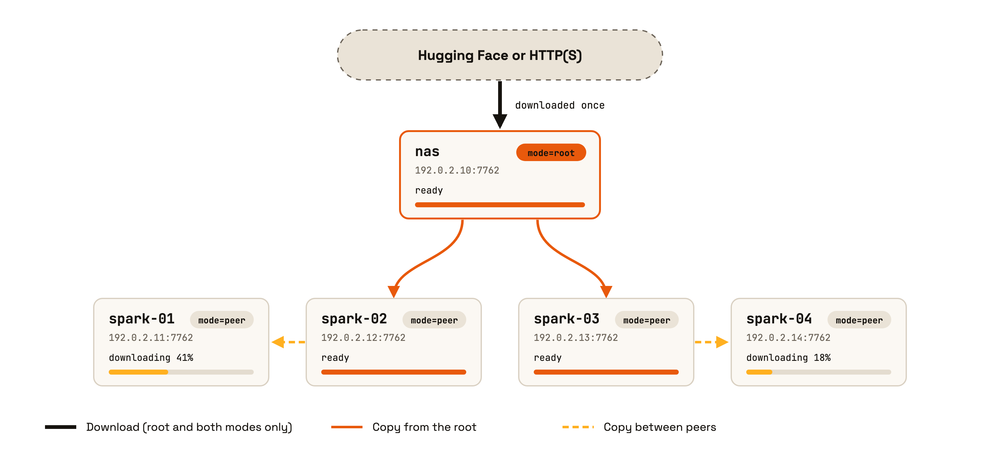
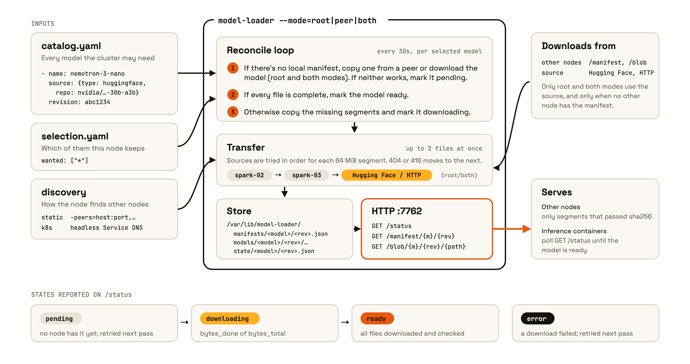
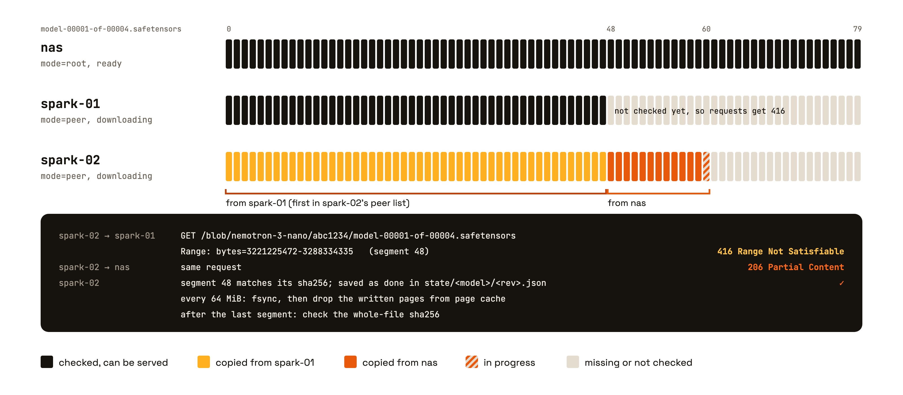

# model-loader

Downloads large model files once and copies them to every machine on your
network. A node that is only serving files it already has uses very little
memory.

<picture>
  <source media="(prefers-color-scheme: dark)" srcset="docs/img/fleet-dark.png">
  
</picture>

Every node runs the same binary. `--mode` sets what it does:

- **root** downloads catalog models from their source (Hugging Face or plain
  HTTP) into its local store. Set `HF_TOKEN` in its environment to fetch
  gated or private Hugging Face repos; the token needs access granted to each
  gated repo.
- **peer** copies missing files from other nodes, either the root or another
  peer. It doesn't need internet access.
- **both** does both. Use this on a single machine.

Every node serves the files it has to the other nodes, so peers can copy from
each other instead of all copying from the root.

<picture>
  <source media="(prefers-color-scheme: dark)" srcset="docs/img/node-dark.png">
  
</picture>

Files are transferred in 64 MiB segments. Each segment is checked against the
sha256 in the manifest before it's marked done or served to other nodes.

<picture>
  <source media="(prefers-color-scheme: dark)" srcset="docs/img/segments-dark.png">
  
</picture>

See [docs/design.md](docs/design.md) for the full design and
[docs/protocol.md](docs/protocol.md) for the wire format.

## Status

Core packages, CLI, and all three deploy targets (k8s, docker compose,
spark-os) are in place and tested. Not yet run against a real model catalog
end-to-end.

## Releases

Releases are automated with `release-please` (`release-please-config.json`,
`.release-please-manifest.json`, `.github/workflows/release.yml`). Pull request
titles follow [Conventional Commits](https://www.conventionalcommits.org/)
(checked by `.github/workflows/pr-title.yml`): before `1.0.0`, `feat:`, `fix:`,
`perf:`, and `revert:` bump the patch version (`0.1.x`), while breaking changes
(`!:` or `BREAKING CHANGE:`) bump the minor version (`0.x.0`); use a
`Release-As: X.Y.Z` footer to request an explicit version.

Merging the Release PR updates `CHANGELOG.md` and `.release-please-manifest.json`,
creates the `vX.Y.Z` tag and GitHub Release, and publishes:

- `ghcr.io/kindlingai/model-loader:<version>` and `:v<version>` for linux/amd64
  and linux/arm64 (plus `:latest` for the newest non-prerelease version). The
  binary is at `/usr/local/bin/model-loader`.
- GitHub Release assets (`model-loader_<version>_linux_{amd64,arm64}.tar.gz`
  and `SHA256SUMS`) with GitHub build-provenance attestations for the tarballs,
  `SHA256SUMS`, and container image:

```bash
gh attestation verify model-loader_<version>_linux_arm64.tar.gz -R kindlingai/model-loader
gh attestation verify oci://ghcr.io/kindlingai/model-loader@sha256:<digest> -R kindlingai/model-loader
```

To republish or backfill an existing `vX.Y.Z` tag manually, trigger
`.github/workflows/release.yml` via `workflow_dispatch` with the `tag` input.

`model-loader -version` prints the version the binary was built from.

## Layout

```
cmd/model-loader/   CLI entrypoint
internal/catalog/   desired-state parsing (catalog.yaml)
internal/store/     local content store, manifests, integrity, disk budget
internal/source/    download sources (http, huggingface)
internal/transfer/  resumable range-fetch engine
internal/want/      what a node must hold: selection to needed segments
internal/request/   named requests from local consumers (gr8), saved in the store
internal/xxh64/     XXH64 (seed 0), for consumer range checksums
internal/discovery/ peer discovery backends (static, k8s DNS, mentat)
internal/server/    LAN-facing HTTP server (status/manifest/blob), local request API
internal/daemon/    reconcile loop tying it together
deploy/k8s/         Kustomize manifests; examples/gr8 runs gr8 beside a peer
deploy/compose/     docker-compose.yml; gr8.yml adds gr8 on the same box
deploy/spark-os/    systemd unit, env template and gr8 compose override
```

## License

AGPL-3.0. See [LICENSE](LICENSE).
